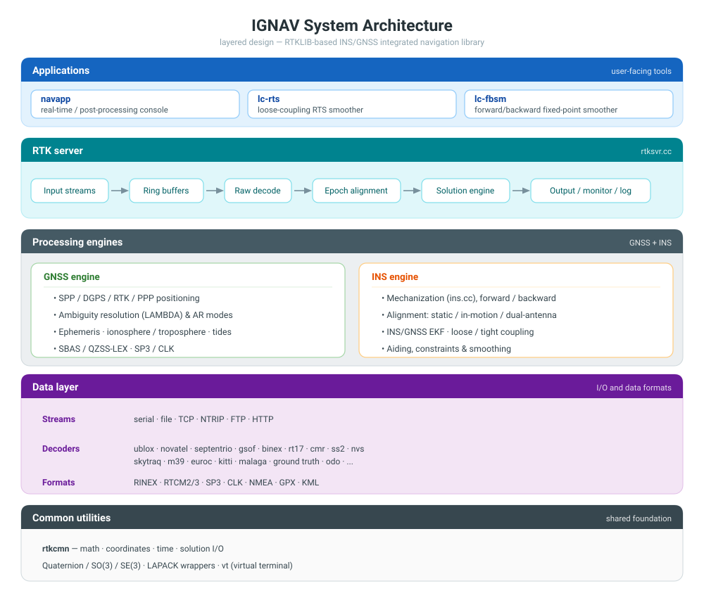
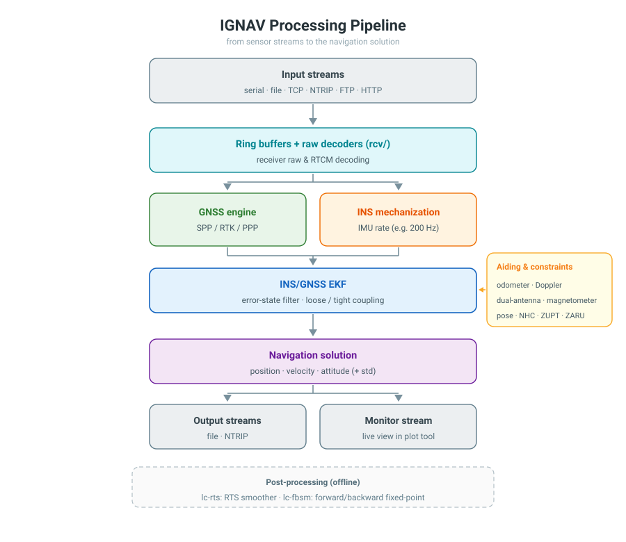

# IGNAV

Integrated Navigation for INS and GNSS

IGNAV is an INS/GNSS integrated navigation library built on RTKLIB for vehicle positioning and multi-sensor fusion. It is written in C/C++ and built with CMake, and currently compiles on Linux only.

## Introduction

The library extends RTKLIB 2.4.3 (b29), keeping the complete RTKLIB GNSS processing chain — SPP/DGPS/RTK/PPP positioning, ambiguity resolution, RINEX/RTCM/raw receiver decoding and real-time streaming — and adds a full inertial navigation system on top:

- INS mechanization in the inertial, local-navigation and ECEF frames, run forward and backward
- Initial alignment: static, in-motion (velocity matching) and dual-antenna, plus user-given initial states
- INS/GNSS coupling implemented as one error-state EKF: loose (position/velocity updates) and tight (raw pseudorange, carrier phase and Doppler updates)
- Aiding and constraints: odometer, Doppler, dual-antenna heading, magnetometer, pose, NHC, ZUPT, ZARU, static detection
- Post-processing: RTS smoother and forward/backward fixed-point smoother
- Preliminary monocular-vision aiding ahead of future camera/LiDAR fusion

The design centers on a unified error-state filter that carries navigation states, sensor calibration parameters and GNSS states together — propagated at the IMU rate (typically 200 Hz) and updated by GNSS and aiding measurements. Interfaces (streams, option files, console commands) follow the RTKLIB conventions, so existing RTKLIB workflows and tools carry over. Typical uses include post-processed kinematic trajectory reconstruction, real-time vehicle navigation with dual-antenna heading, and research on multi-sensor state estimation.

The project keeps evolving toward vision (camera) and LiDAR fusion. An early vision-integrated variant is kept in [improved/](improved/) (the CarViG project).

## Features

**GNSS positioning**

- SPP, DGPS, RTK (with WLNL, TCAR and other ambiguity resolution modes), PPP/PPP-AR
- Standard formats: RINEX, RTCM2/3, SBAS, SP3, CLK

**INS/GNSS integration**

- Loosely coupled: GNSS position and velocity updates to the INS filter
- Tightly coupled: pseudorange, carrier phase and Doppler observations directly update the filter, including RTK/INS double-difference tight coupling
- Standalone INS mechanization (dead reckoning without GNSS updates)

**Auxiliary observations and motion constraints**

- Odometer aiding with online estimation of scale factor, lever arm and misalignment
- Dual-antenna heading aiding with misalignment calibration
- Doppler, magnetometer and pose aiding
- NHC, ZUPT, ZARU and static detection
- Preliminary monocular-vision (VO) aiding; the full vision stack is in CarViG below

**Initialization and alignment**

- Static alignment, in-motion (velocity matching) alignment, dual-antenna alignment, and user-given initial states

**Post-processing**

- Loosely coupled RTS smoothing: `lc-rts`
- Forward/backward mechanization with fixed-point smoothing: `lc-fbsm`

**Data interfaces**

- Receiver/data formats: rtcm2, rtcm3, oem4, oem3, ubx, ss2, hemis, skytraq, gw10, javad, nvs, binex, rt17, sbf, cmr, tersus, nmea, gsof, sp3, rnxclk, sbas, ublox, m39, rinex, euroc, karl, malaga, oem6, etc.
- Input streams: serial, file, TCP, NTRIP, FTP, HTTP; output streams include NTRIP caster
- Solution output formats: llh/xyz/enu, NMEA, status, INS states, VO states

## System architecture

### Layered design

IGNAV follows the layered structure inherited from RTKLIB, with the INS processing built into the solution engine instead of being bolted on as a separate filter.



### Processing pipeline



One server thread (`rtksvr.cc`) reads and decodes all input streams, aligns measurements by epoch and runs the solution engine; results go to the output/log streams and to a monitor stream for the plot tool. The post-processing tools reuse the same processing core offline: `lc-rts` runs a forward filter followed by an RTS smoother; `lc-fbsm` additionally runs a backward mechanization/filter and combines both passes with a fixed-point smoother.

### Estimator design

The core estimator is an error-state EKF with closed-loop correction. Navigation states, sensor calibration parameters and GNSS states share one state vector — which is what makes tight coupling possible. The active blocks are controlled by options; layout and indices are defined in `src/ins-gnss/ins-gnss-state.cc`.

| Group | States | Controlled by |
| --- | --- | --- |
| Core navigation | position (3), velocity (3), attitude (3) | always on |
| IMU biases | accelerometer bias (3), gyroscope bias (3) | `ins-baopt`, `ins-bgopt` |
| IMU calibration | gyro/accel scale factors (3+3), axis non-orthogonality (6+6) | `ins-estsg` … `ins-estra` |
| Time synchronization | IMU–GNSS time offset (1) | `ins-estdt` |
| Antenna lever arm | body-frame antenna lever arm (3) | `ins-estlever` |
| Odometry | scale factor (1), lever arm (3), frame misalignment (3) | `ins-estodos` … `ins-estodoa` |
| Camera (vision) | camera–IMU misalignment (3), body-to-v-frame misalignment (3) | `ins-estcama`, `ins-estmisv` |
| GNSS (tight mode) | receiver clock bias/drift (4), ionosphere (per sat), troposphere, GLONASS hardware bias, L5 DCB, phase biases (per sat/freq) | coupling options |

### Processing modes

`pos1-posmode` selects the processing chain (values from `include/navlib.h`):

| Mode | Value | Chain |
| --- | --- | --- |
| `single` | 0 | standalone GNSS |
| `dgps` | 1 | DGPS/DGNSS |
| `kinematic` / `static` | 2 / 3 | RTK carrier-phase |
| `movingbase` / `fixed` | 4 / 5 | moving baseline / base coordinates fixed |
| `ppp-kine` / `ppp-static` / `ppp-fixed` | 6 / 7 / 8 | PPP (AR optional) |
| `ins-update` | 9 | pure INS mechanization, no GNSS update |
| `ins-loosely-coupled` | 10 | INS/GNSS loose coupling |
| `ins-tightly-coupled` | 11 | INS/GNSS tight coupling (pseudorange / carrier / Doppler) |
| `ins-vo-loosely-coupled` | 12 | INS + visual odometry loose coupling (preliminary) |
| `vo` | 13 | visual odometry only (preliminary) |

### Key modules

All file names below are under `src/ins-gnss/` unless noted.

| Area | Modules |
| --- | --- |
| RTK server & console | `rtksvr.cc`, `stream.cc`, `streamsvr.cc`, `vt.cc` |
| GNSS engine | `rtkpos.cc`, `pntpos.cc`, `ppp.cc`, `ppp_ar.cc`, `ppp_corr.cc`, `lambda.cc`, `ephemeris.cc`, `preceph.cc`, `ionex.cc`, `sbas.cc`, `qzslex.cc`, `tides.cc` |
| INS core | `ins.cc`, `ins-gnss.cc`, `ins-gnss-tc.cc`, `ins-gnss-psi.cc`, `ins-gnss-state.cc` |
| Alignment | `ins-align.cc`, `ins-vel-match-align.cc`, `ins-init-rt.cc`, `ins-static-detect.cc` |
| Aiding | `ins-odo.cc`, `ins-doppler.cc`, `ins-dualant-calib.cc`, `ins-geomag.cc`, `ins-pose.cc` |
| Constraints | `ins-nhc.cc`, `ins-zvu.cc`, `ins-zaru.cc` |
| Smoothing | `ins-gnss-rts.cc`, `ins-gnss-fbsm.cc`, `ins-back-mech.cc` |
| Vision (preliminary) | `ins-camera.cc`, `ins-vo.cc`, `ins-vo-aid.cc` |
| Receiver decoders | `rcv/` (ublox, novatel, septentrio, gsof, binex, rt17, cmr, ss2, nvs, skytraq, m39, euroc, kitti, malaga, ...) |
| Formats & utilities | `rinex.cc`, `rtcm*.cc`, `solution.cc`, `rtkcmn.cc`, `quaternion.cc`, `so3.cc`, `se3.cc`, `svd.cc`, `geoid.cc`, `datum.cc`, `gis.cc` |

## Project layout

```text
IGNAV/
├── CMakeLists.txt          Build script: navlib static library + 3 console apps
├── include/                Public headers (navlib.h, geomag.h, queue.h, egm9615.h)
├── src/ins-gnss/           Core source
│   ├── app/                App entry points: rtkrcv.cc (navapp), lc-rts.cc, lc-fbsm.cc
│   ├── rcv/                Receiver raw data decoders: ublox, novatel, septentrio, binex, gsof, ...
│   ├── ins-*.cc            INS algorithms: mechanization, alignment, constraints, aiding, smoothing
│   └── *.cc                RTKLIB positioning engine and common modules: rtkpos, ppp, rinex, rtcm, stream, ...
├── example/
│   ├── conf/               Example configuration navlib.conf
│   ├── data/               Three sample datasets
│   └── demo/               Six algorithm demos
├── improved/               CarViG: INS/GNSS/vision integration project, see improved/README.md
├── man/                    ignav.doc user guide; theory.doc/pdf theory notes
├── data/geomag/            Geomagnetic model data (IGRF12, WMM2015)
├── plot/                   Trajectory plotting tool and plot.ini
├── bin/                    Build output: navapp, lc-rts, lc-fbsm
└── lib/                    Build output: libnavlib.a
```

Prebuilt x86-64 Linux binaries are already shipped in `bin/` and `improved/bin/`.

## Build

Requirements: a Linux system, CMake (2.8 or later), a C++11-capable GCC, and BLAS, LAPACK, zlib and pthread.

Install dependencies on Ubuntu/Debian:

```bash
sudo apt-get install build-essential cmake libblas-dev liblapack-dev zlib1g-dev
```

Build:

```bash
mkdir -p build && cd build
cmake ..
make -j$(nproc)
```

The build produces `lib/libnavlib.a` and three executables in `bin/`: navapp, lc-rts and lc-fbsm. The default build is Debug without optimization; for long datasets you may enable optimization in CMakeLists.txt.

## Usage

### navapp

navapp is the main application. It runs an RTK server with a console front-end, and works with both real-time streams and data files. For example:

```bash
cd bin
./navapp -o ../example/conf/navlib.conf -m 52716
```

Common options:

| Option | Description |
| --- | --- |
| `-o file` | Options file (default: rtkrcv.conf) |
| `-s` | Start the RTK server on program startup (otherwise type `start`) |
| `-m port` | Monitor stream port for the plot tool |
| `-p port` | Telnet console port |
| `-w pwd` | Login password for remote console |
| `-r level` | Solution status output (0: off, 1: states, 2: residuals) |
| `-t level` | Debug trace level (0: off, 1-5: on) |
| `-sta sta` | Station name for receiver DCB |
| `-pause` / `-resume` | Pause/resume processing, commonly used in post-processing |
| `-reinit` | Re-initialize INS states |

Run `./navapp` without arguments to see the full help. Useful console commands: start, stop, restart, solution, status, satellite, observ, imudata, option, set, load, save, log, pause, resume, reinit, shutdown. Output files follow the `outstr*-path` options and are written to the working directory by default.

### lc-rts and lc-fbsm

Loosely coupled post-processing tools; `-o` selects the options file:

```bash
./bin/lc-rts  -o <options file>    # RTS smoother
./bin/lc-fbsm -o <options file>    # forward/backward fixed-point smoother
```

## Configuration

Options follow the RTKLIB convention (see the RTKLIB manual for details); an example is provided in `example/conf/navlib.conf`. INS-specific options share the `ins-` prefix. Main groups:

- Positioning mode `pos1-posmode` selects the processing chain (see **Processing modes** above)
- Coupling mode `ins-tc`/`ins-lc`: tightly/loosely coupled observation mode (1 single, 2 ppk, 3 dgps, 4 rtk)
- IMU parameters: `ins-hz` sampling rate, `ins-psd_*` noise PSD, `ins-imu*` data format and frame
- Initial uncertainties: `ins-unc*`
- Constraints and aiding: `ins-nhc`, `ins-zvu`, `ins-zaru`, `ins-doppler`, `ins-odo_*`, `ins-align-dualant`, `ins-pose-aid`
- Vision aiding: `ins-vo-aid-*` (camera intrinsics/extrinsics, image size, feature matching parameters)
- Input/output streams: `inpstr*-type/path/format`, `outstr*-type/path/format`

Data paths in the example configurations are absolute paths from the author's machine; update them before running.

## Example data and demos

| Directory | Contents |
| --- | --- |
| `example/data/1` | GNSS solution file (.gps) and IMU data (.imu) |
| `example/data/2` | Base station (RINEX observation, base coordinates) and rover (GSOF position, RT27 raw stream, IMU) |
| `example/data/3` | Full RTK dataset: base observations, ephemeris and RTCM correction stream; rover RINEX, raw observations and IMU |
| `example/demo/` | Six demos: LC loose coupling (LC-1, LC-3, LC-B), TC tight coupling, RTS smoothing, FB forward/backward, with configurations, videos and some solution results |

Large files (videos, IMU data, some configurations) are tracked with Git LFS. If a cloned file contains a pointer like `version https://git-lfs.github.com/spec/v1`, run `git lfs pull` to fetch its content.

## Documentation

The `man/` directory provides two documents (in Chinese):

- `ignav.doc`: user guide covering configuration files, build and run
- `theory.doc`, `theory.pdf`: theory notes on reference frames and transformations, INS navigation equations (inertial/local-navigation/ECEF frames), IMU error models and calibration (six-position method, Allan variance), GNSS/INS observation equations (position/velocity aiding, pseudorange/carrier/Doppler, RTK tight coupling, odometer aiding, dual-antenna heading), quaternions and Kalman filtering

## CarViG: INS/GNSS/vision integration (improved/)

A vehicle positioning project adding visual information to the INS/GNSS stack. It provides monocular/stereo visual odometry, vision-aided integration, online camera parameter estimation, relative pose estimation and an experimental MSCKF implementation. It is an independent CMake project with extra dependencies on OpenCV, Eigen3 and Python development libraries; see [improved/README.md](improved/README.md).

## Plotting tool

`plot/plot` is a prebuilt trajectory plotting program (x86-64 Linux) configured by `plot/plot.ini`. It can connect to the navapp monitor port (`-m`) for live trajectory display, or open a solution file afterwards to inspect trajectory and solution states.

## References

- RTKLIB: <http://www.rtklib.com>
- P. D. Groves, Principles of GNSS, Inertial, and Multisensor Integrated Navigation Systems, Artech House
- Wuhan MAP Navigation Technology Co., Ltd.: <http://www.whmpst.com/cn/>

## Contact

- Su Jinglan, GNSS Research Center, Wuhan University
- QQ: 1971129844
- Email: <sujinglan@whu.edu.cn>
