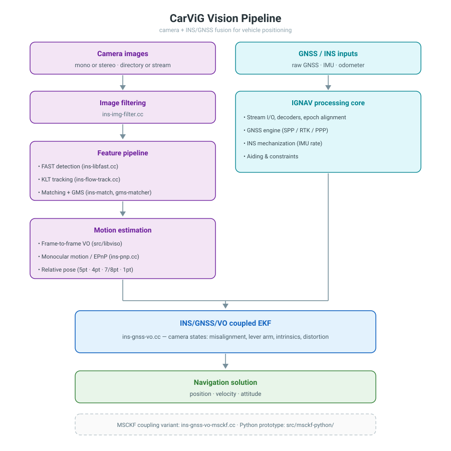

# CarViG

Integrated Navigation for INS/GNSS/Vision for Vehicle Positioning

CarViG extends [IGNAV](../README.md) with visual information for vehicle positioning.

## Introduction

CarViG adds camera-based information on top of the INS/GNSS navigation stack: monocular/stereo visual odometry, vision-aided INS/GNSS integration, online camera parameter estimation and relative pose estimation. It targets vehicle positioning in GNSS-degraded environments such as urban canyons, tree-lined roads and tunnels. It is an independent CMake project and can be built separately from the main project.

## Features

- Vision-aided INS/GNSS coupling (`pos1-posmode = ins-gnsslc-vo-coupled`)
- Feature pipeline: FAST corners (`ins-libfast.cc`), KLT tracking (`ins-flow-track.cc`), stereo/mono matching (`ins-match.cc`) with GMS outlier filtering (`gms-matcher.cc`, optional CUDA acceleration)
- Monocular/stereo visual odometry (libviso-derived library in `src/libviso`), monocular two-view motion and EPnP pose estimation (`ins-vo-mono.cc`, `ins-pnp.cc`)
- Online camera parameter estimation: intrinsics (fx, fy, cx, cy), distortion (k1, k2, p1, p2), camera-IMU lever arm and misalignment (`ins-estcam*`, `ins-unc-cam*`)
- Relative pose estimation algorithms (`src/relative-pose`): Nister five-point, Groebner-basis four-point, seven/eight-point, one-point
- MSCKF-based coupling variant and a Python MSCKF implementation (`ins-gnss-vo-msckf.cc`, `src/msckf-python`)
- Multi-sensor simulation and post-processing for the VO-coupled chain (`ins-gnss-vo-sim.cc`, `ins-gnss-vo-postpos.cc`)
- Extended data formats: euroc, kitti, malaga, m39-mix, oem6-sol/pose/raw, IGV simulation data, etc.
- Inherits the full INS/GNSS capability of IGNAV: loose/tight coupling, motion constraints, alignment initialization, RTS and forward/backward smoothing

## Architecture

CarViG keeps the IGNAV processing core and adds a vision front-end plus a VO-aided coupling filter. Camera models are pinhole with radial-tangential distortion (`CAM_PINHOLE` / `DISTORT_RT` in `carvig.h`); image input can be a directory of images (`file-monodir`) or dataset streams (euroc, kitti, malaga, m39-mix).



Main modules (files under `src/ins-gnss/` unless noted):

| Area | Modules |
| --- | --- |
| Vision-extended server | `carvigsvr.cc` |
| Image pipeline | `ins-img-filter.cc`, `ins-libfast.cc`, `ins-track.cc`, `ins-flow-track.cc`, `ins-match.cc`, `gms-matcher.cc`, `ins-track-visualizer.cc` |
| Motion estimation | `ins-vo-mono.cc`, `ins-pnp.cc`, `ins-vo-opencv-interface.cc`, `src/libviso/` |
| Relative pose | `src/relative-pose/` (five-point Nister, four-point Groebner, seven/eight-point, one-point) |
| VO fusion | `ins-gnss-vo.cc` (coupled EKF), `ins-gnss-vo-msckf.cc` (MSCKF variant) |
| Post-processing / simulation | `ins-gnss-vo-postpos.cc`, `ins-gnss-vo-sim.cc` |
| MSCKF (Python) | `src/msckf-python/` |

## Project layout

```text
improved/
├── CMakeLists.txt
├── cmake/FindEigen3.cmake
├── include/                carvig.h and common headers
├── src/
│   ├── ins-gnss/           Core integration code (app/, rcv/ and algorithm modules)
│   ├── libviso/            Monocular/stereo visual odometry library
│   ├── relative-pose/      Relative pose estimation algorithms
│   └── msckf-python/       MSCKF implementation in Python
├── data/geomag/            Geomagnetic model data (IGRF12, WMM2015)
├── bin/                    Build output: carvignav, tc-postpos
└── lib/                    Build output (created by the build)
```

Prebuilt x86-64 Linux binaries are already shipped in `bin/`.

## Build

Requirements are the same as IGNAV (Linux, CMake, C++11), plus:

- OpenCV 2.4.3 or 3.x (CMake searches for 3.x first, then 2.4.3)
- Eigen3 3.1 or later
- Python development libraries (checked via `find_package(PythonLibs)`)
- BLAS, LAPACK, zlib, pthread
- libpng, jpeg (CMake references `/usr/local/lib/libpng.so`; adjust if your system differs)

```bash
cd improved
mkdir -p build && cd build
cmake ..
make -j$(nproc)
```

The build produces `improved/bin/carvignav` and `improved/bin/tc-postpos` plus several static libraries.

## Usage

```bash
cd improved
./bin/carvignav -o src/ins-gnss/app/carvig.conf
```

- `carvignav`: main console application; its options are similar to navapp (`-s`, `-p`, `-m`, `-o`, `-w`, `-r`, `-t`, `-sta`, ...; run it without arguments for help)
- `tc-postpos`: tightly coupled post-processing tool, with `-p` (console port) and `-o` (options file)

Four options files are provided in `src/ins-gnss/app/`:

| File | Purpose |
| --- | --- |
| `carvig.conf` | INS/GNSS loosely coupled + vision fusion (default) |
| `carvig-lc.conf` | INS/GNSS loosely coupled |
| `carvig-tc.conf` | INS/GNSS tightly coupled |
| `carvig-sim.conf` | Simulated data (gps/imu/vo simulation files) |

Input paths (`inpstr*-path`, `file-monodir`, ...) in these files are absolute paths from the author's machine; update them before running.

## References

- RTKLIB: <http://www.rtklib.com>
- OpenCV: <https://opencv.org/>
- Eigen: <https://eigen.tuxfamily.org/>
- Libviso: <http://www.cvlibs.net/software/libviso/>

## Contact

- QQ: 1971129844
- Email: <sujinglan@whu.edu.cn>
